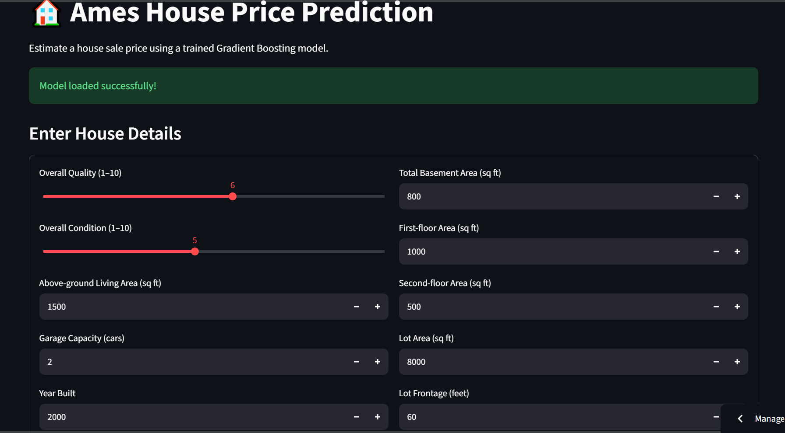

# 🏡 Ames House Price Prediction

A machine learning web application that estimates house sale prices using the Ames Housing dataset and a trained Gradient Boosting Regressor.

## 🚀 Live Demo

**Try the application:** [Ames House Price Prediction](https://ames-housing-price-prediction-hnkau7mmfndzt38yvwzjkz.streamlit.app)

## 📌 Project Overview

The goal of this project is to predict a house's estimated sale price based on its characteristics, such as overall quality, living area, year built, basement area, and garage capacity.

The project covers the complete machine learning workflow, from data preprocessing and model evaluation to web application development and deployment.

## 🛠️ Technologies Used

- Python
- Pandas and NumPy
- Scikit-learn
- Gradient Boosting Regressor
- Streamlit
- Joblib
- Git and GitHub

## ⚙️ Machine Learning Workflow

1. Load and explore the Ames Housing dataset.
2. Preprocess numerical and categorical features.
3. Train and evaluate multiple regression models.
4. Compare Linear Regression, Random Forest, and Gradient Boosting.
5. Save the trained model using Joblib.
6. Build an interactive web application using Streamlit.
7. Deploy the application using Streamlit Community Cloud.

## 📊 Model Performance

The Gradient Boosting Regressor achieved the following results on the project's evaluation data:

| Metric | Result |
|---|---:|
| MAE | 16,885.97 |
| RMSE | 26,952.47 |
| R² Score | 0.9053 |

These values are from the model evaluation performed during development. The R² score indicates that the model explained approximately 90.53% of the target variance on that evaluation split.

## 💻 Run the Project Locally

### 1. Clone the repository

```bash
git clone https://github.com/rohan2005-1822/ames-housing-price-prediction.git
cd ames-housing-price-prediction
```

### 2. Create and activate a virtual environment

```bash
python -m venv .venv
```

Windows PowerShell:

```powershell
.\.venv\Scripts\Activate.ps1
```

### 3. Install dependencies

```bash
pip install -r requirements.txt
```

### 4. Run the application

```bash
streamlit run app.py
```

## 📁 Project Structure

```text
ames-housing-price-prediction/
├── app.py
├── requirements.txt
├── data/
│   └── train.csv
├── models/
│   └── gradient_boosting_model.pkl
└── notebooks/
    └── house_price_prediction.ipynb
```

## ⚠️ Disclaimer

The predicted price is a machine learning estimate, not a guaranteed market or selling price. Some house features use default values when they are not entered in the application, which can affect prediction accuracy.

## 👨‍💻 Author

Developed as a machine learning project to practice regression, model evaluation, and deployment.

## 📸 Application Screenshot

